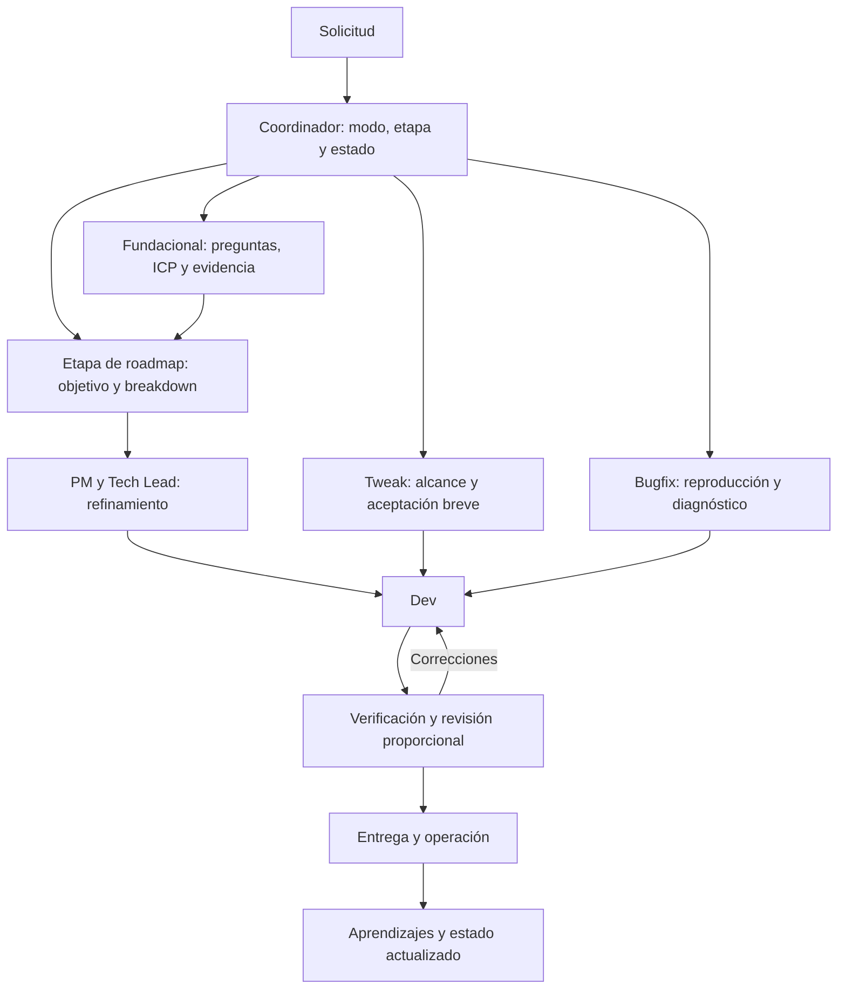

# Célula de producto con Codex

Un sistema de trabajo para convertir ideas en productos y evolucionarlos con agentes especializados, contexto persistente y verificaciones proporcionales al cambio. Este repositorio documenta y construye ese sistema por etapas, empezando por un piloto en Gym Tracker o CEDEAR Tracker.

**Estado actual:** E00 completada: repositorio y documentación inicial. **Próximo paso:** E01, elegir el repo piloto y consolidar sus reglas existentes. Los agentes personalizados, las skills, el pipeline y el RAG todavía no están instalados ni probados.

## Empezar y retomar

1. Abrir esta carpeta como proyecto independiente en Codex.
2. Leer [estado actual](docs/STATUS.md) y [roadmap de construcción](docs/ROADMAP.md).
3. Usar la [guía paso a paso](docs/SETUP.md) para ejecutar la etapa pendiente.
4. Al cerrar, actualizar estado, tarea y [bitácora](docs/LOG.md).

Prompt para retomar:

> Leé AGENTS.md y docs/STATUS.md. Retomá el próximo paso pendiente del roadmap. Comprobá los archivos y la evidencia antes de asumir avances. Ejecutá el alcance autorizado, registrá decisiones y cerrá con último paso completado, verificaciones, pendientes y próxima acción. No avances por todas las etapas automáticamente.

## Estructura de la célula

| Rol | Responsabilidad | Entrega |
|---|---|---|
| Coordinador, agente principal | Clasificar el trabajo, leer estado, asignar roles y comprobar pases | Estado consistente y próxima acción |
| PM | Discovery, ICP, prioridades, experiencia y aceptación funcional | Brief, roadmap e historias claras |
| Tech Lead | Viabilidad, arquitectura, restricciones y refinamiento técnico | Plan implementable y verificable |
| Dev | Implementar tareas delimitadas | Código y evidencia de pruebas |
| Reviewer | Revisar de forma independiente la solución y la aceptación | Hallazgos concretos o conformidad |
| DevOps | Entrega, rollback y operación | Despliegue comprobado y runbook |

Los especialistas se ejecutarán como **subagentes bajo demanda**. El coordinador no abre todos los roles por defecto. Discovery y análisis funcional son responsabilidades del mismo PM en momentos distintos.



## Cuatro modos de trabajo

| Modo | Disparador | Recorrido mínimo |
|---|---|---|
| Fundacional | Nueva idea o cambio sustancial de cliente o problema | Cinco preguntas → ICP hipotético → evidencia → viabilidad → roadmap |
| Etapa de roadmap | Nuevo resultado dentro de un producto definido | Objetivo → breakdown → historias → refinamiento → desarrollo → revisión → entrega |
| Tweak | Cambio local, claro y de bajo impacto | Triage → implementación → verificación proporcional |
| Bugfix con learning | Diferencia entre comportamiento esperado y real | Reproducción → diagnóstico → corrección → regresión → aprendizaje |

La urgencia no convierte un cambio en tweak. El modo elige el recorrido; el riesgo determina la profundidad. Un incidente puede requerir mitigación inmediata y diagnóstico posterior registrado.

## Decisiones clave

1. **Estado en archivos versionados.** La continuidad depende del repo, no de recordar el chat. Se distinguen etapa del producto, modo de trabajo y estado de tarea.
2. **Arnés por rol.** Cada especialista tiene entradas, contexto, herramientas, límites, verificaciones, salida y escalamiento explícitos.
3. **Controles proporcionales.** Las instrucciones guían; CI, permisos y validaciones aportan controles ejecutables. Un rol escrito no crea aislamiento de seguridad.
4. **Modelos según incertidumbre.** Refinamiento y diagnóstico complejo usan un modelo fuerte; ejecución cerrada puede usar uno económico. Medir costo hasta aceptación, incluyendo retrabajo.
5. **Delegación selectiva.** Sin agentes permanentes ni conversaciones entre todos. El coordinador puede resolver un ajuste trivial; la revisión independiente se reserva según riesgo.
6. **Contexto mínimo suficiente.** Entregar spec vigente, constraints aplicables y referencias precisas. No copiar todo el historial a cada subagente.
7. **Definición funcional protegida.** Dev no cambia aceptación para hacer pasar la implementación. Cambios de experiencia vuelven al PM.
8. **RAG gradual.** Primero documentos curados y búsqueda textual. Después recuperación híbrida si mejora búsquedas reales. Estado, spec y reglas obligatorias se leen directamente.
9. **Aprendizaje accionable.** Cada bug deja prevención proporcional: prueba, alerta, documentación o runbook. Solo las reglas generales y duraderas pasan a AGENTS.md.
10. **Construcción por etapas.** Validar el sistema en un tracker antes de generalizarlo al segundo. Diferenciar siempre creado, configurado, probado y operando.

Detalle y consecuencias: [registro de decisiones](docs/DECISIONS.md).

## Qué es un arnés en este proyecto

Es la combinación de instrucciones del rol, contexto seleccionado, herramientas disponibles, permisos del entorno, gestión de estado, condiciones de avance y evidencia. Incluye tanto acuerdos de trabajo como controles ejecutables. La especificación está en [arneses y subagentes](docs/HARNESSES.md).

## Dónde encaja el RAG local

Recupera decisiones históricas, incidentes, learnings y conversaciones exportadas. No reemplaza las fuentes vigentes. Todo resultado conserva proyecto, fecha, estado y referencia. Los documentos recuperados son evidencia, no instrucciones ejecutables.

Un índice local no implica procesamiento totalmente local: embeddings externos y fragmentos enviados a un modelo remoto salen de la máquina. El plan está en [conocimiento y RAG](docs/RAG.md).

## Mapa del repositorio

```text
AGENTS.md                 Instrucciones para trabajar en este repo
README.md                 Visión y decisiones principales
state/project.json        Estado estructurado de construcción
scripts/check_state.py    Validación básica de estado y referencias
docs/                     Guías, decisiones, avance y evidencias
templates/                Plantillas de tareas, contexto y agentes
```

- [Guía de instalación por etapas](docs/SETUP.md)
- [Roadmap y criterios de salida](docs/ROADMAP.md)
- [Estado y último paso](docs/STATUS.md)
- [Bitácora cronológica](docs/LOG.md)
- [Flujos por modo](docs/WORKFLOWS.md)
- [Arneses y política de tokens](docs/HARNESSES.md)
- [Plan de RAG local](docs/RAG.md)
- [Decisiones](docs/DECISIONS.md)
- [Fuentes de configuración](docs/SOURCES.md)
- [Plantilla de tarea](templates/TASK.md)

## Verificación y Git

Desde la raíz:

```sh
python3 scripts/check_state.py
git status --short
git log -5 --oneline
```

La validación comprueba estructura, referencias y coherencia básica del avance; no certifica que los agentes funcionen. Usar ramas `codex/<tema>` para cambios posteriores y commits pequeños con evidencia. Repositorio privado publicado en [GitHub](https://github.com/speranza5/product-cell), con `origin` configurado y `main` sincronizada al publicar.
